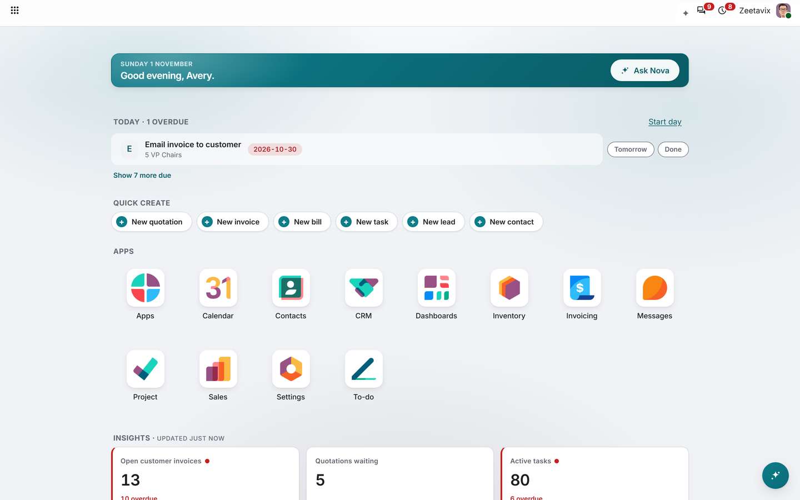
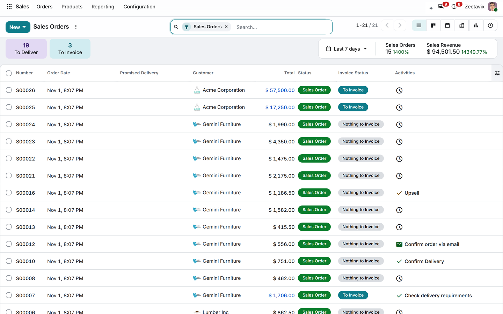
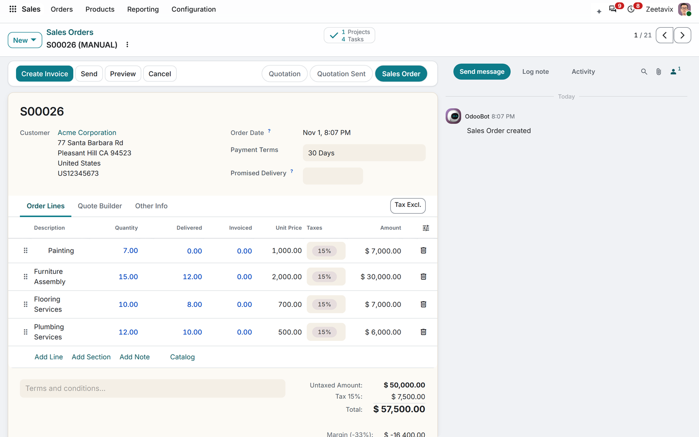
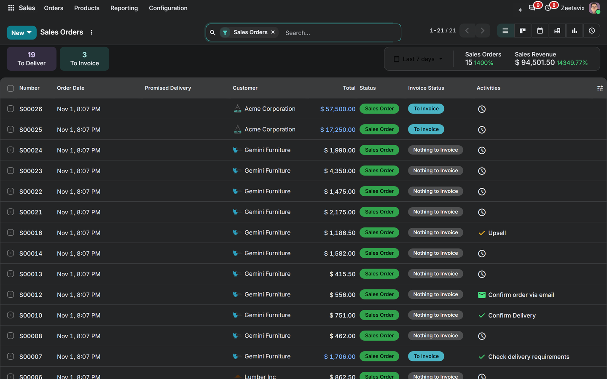
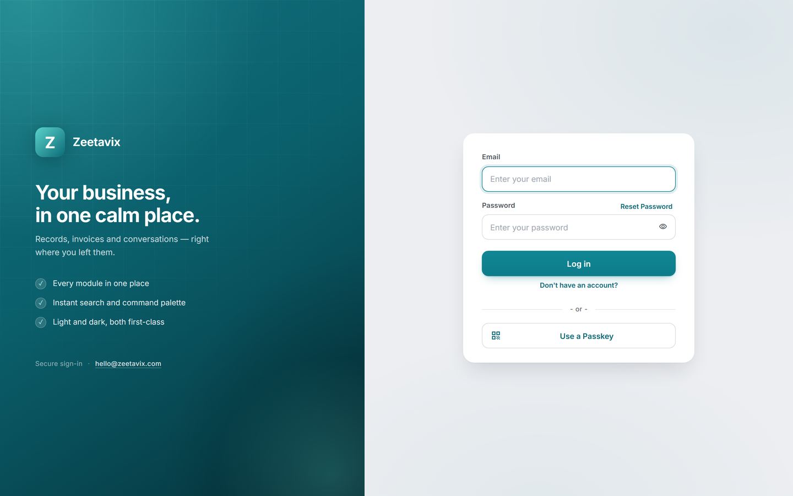
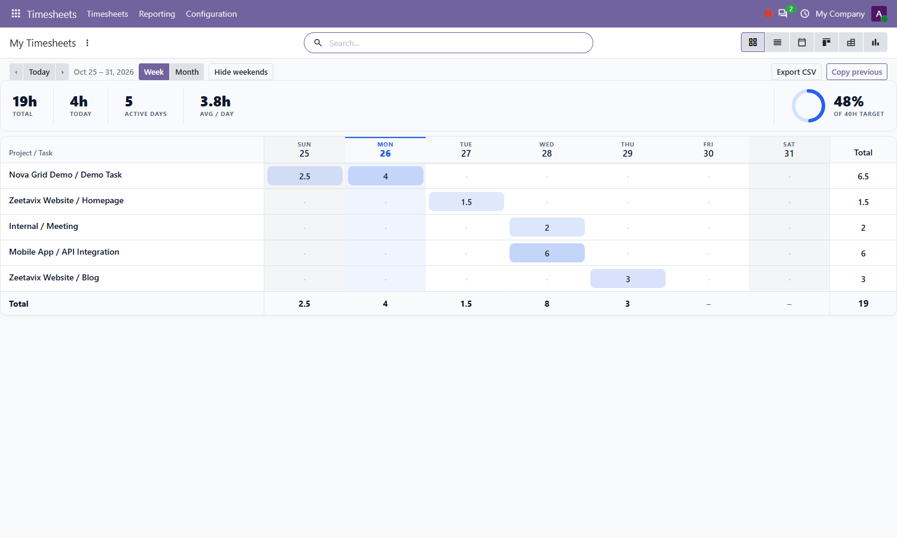
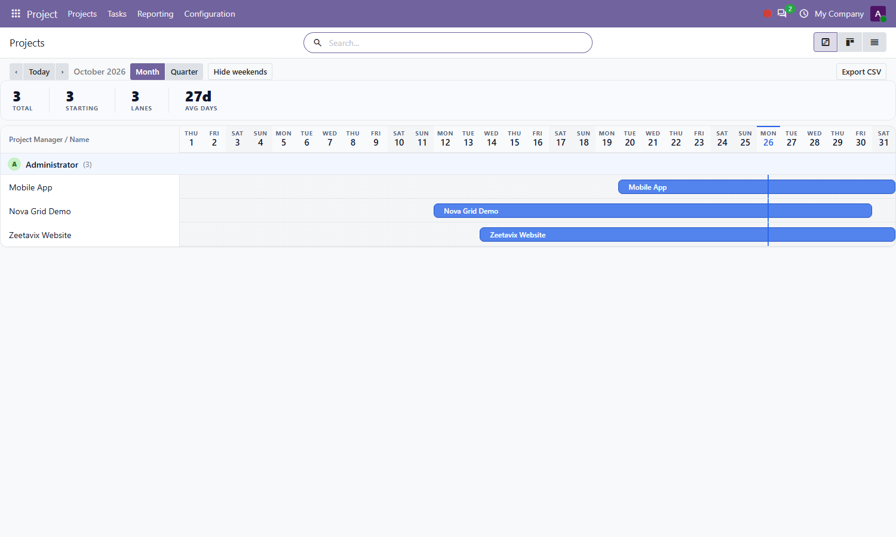
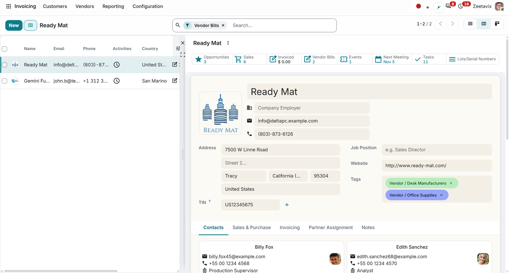
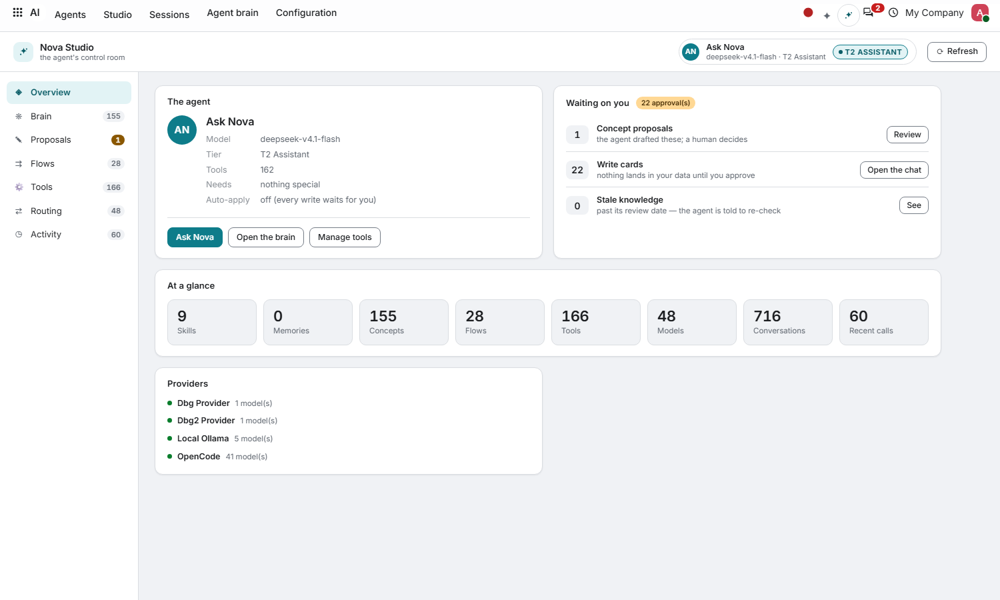
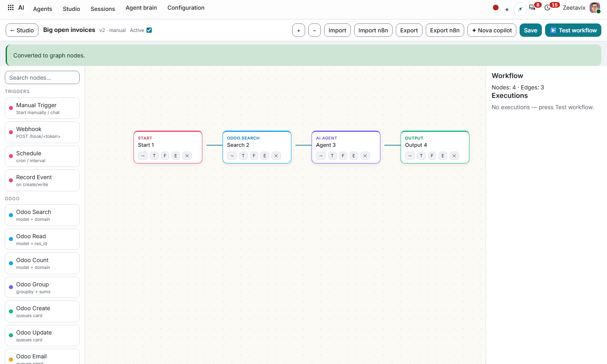

# Nova — free Odoo 20 Community addons by Zeetavix

A backend theme, 2D grid/Gantt/split views, per-app use-cases, and a
model-agnostic AI agent layer — **all free and open source (LGPL-3)**.
No Enterprise code copied or required, anywhere.

## Why Nova

- **One accent, yours** — six presets or any brand hex, per company; light
  and dark themes designed separately, never inverted.
- **White-label branding** — brand name, login logo and favicon per company.
- **Real views, not skins** — generic `<grid>` and `<gantt>` engines any
  model can use, plus a split view that docks any form beside its list.
- **AI with guardrails** — capability tiers, confirm cards, audit log, 29
  library flows, offline voice. Your model, your data.

## Tour

| | |
|---|---|
| Light lists, calm and scannable |  |
| Forms that read like paper |  |
| A real dark theme |  |
| Your identity on the login page |  |

### Views

| Grid engine — any rows, any period | Gantt engine — lanes, drag, resize |
|---|---|
|  |  |

Split view: list left, form right, zero per-model work.

### AI agents

Chat in the drawer, threads read post by post, replies drafted from the
record, flows as steps or node graphs, 166 tiered tools, any model.

## All addons

| Addon | What it does |
|---|---|
| `nova_backend_theme` | Calm, accessible, white-label backend theme + dark mode + branded login |
| `nova_backend_theme_mail` | Free bridge: renames stock Discuss menus to Messages when `mail` is present |
| `nova_backend_theme_portal` | Free bridge: syncs the company accent to the customer portal |
| `nova_grid` | Generic `&lt;grid&gt;` view engine: rows, date/selection/many2one columns, inline editing, totals, heatmap, dark mode |
| `nova_gantt` | Generic `&lt;gantt&gt;` view engine: lanes, drag-to-move, edge-resize, today line, dialogs |
| `nova_split` | Split view: list left, form panel right, zero per-model work |
| `nova_attendance_grid` | My Attendance grid (`hr_attendance`) |
| `nova_leave_grid` | Leave grid (`hr_holidays`) |
| `nova_timesheet_grid` | Timesheet grid with KPI dashboard (`hr_timesheet`, `project`) |
| `nova_project_workload_grid` | Project workload grid (`project`) |
| `nova_event_gantt` | Events Gantt (`event`) |
| `nova_leave_gantt` | Who-is-out Gantt (`hr_holidays`) |
| `nova_project_gantt` | Project portfolio Gantt (`project`) |
| `nova_ai` | AI agents: tiers, Studio control room, 29 library flows with node canvas, knowledge, schedules, chat drawer, offline voice |

The use-case grid/Gantt modules depend on their engine, so installing one
pulls the engine in automatically. `nova_ai` needs the backend theme.

Each addon ships its own Store listing (`static/description/index.html`
with screenshots), icon, cover art, README and LICENSE.

## Installation

1. Copy the addon folders you need into your addons path.
2. Update the apps list (`-u base` or the Apps menu).
3. Install the addons you want (theme first if you use `nova_ai`).
4. Theme: Settings › Appearance. AI: Settings › Nova AI.

## Support & contributions

- Questions: **support@zeetavix.com**
- Found a bug? Please [open a GitHub issue](https://github.com/zeetavix/nova_backend_theme/issues) —
  public issues help everyone and build this project in the open.
- Pull requests welcome: keep Odoo 20 Community compatibility, no
  Enterprise code, LGPL-3 headers intact.

## License

LGPL-3 (GNU Lesser General Public License v3.0) — see [LICENSE](LICENSE).
Free and open source; a license file ships with every addon.

Odoo is a trademark of Odoo S.A. This repository contains addons for Odoo
and is neither affiliated with nor endorsed by Odoo S.A. No Odoo source
code is distributed here.
